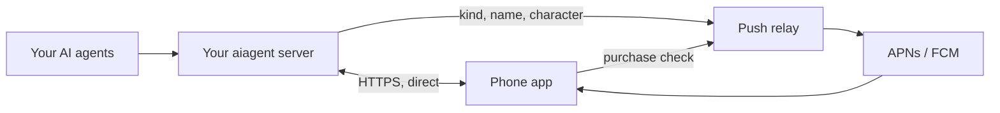

# aiagent — AI Agent World

**Your AI team. In your pocket. On your own infrastructure.**

A personal command center for the real AI coding agents running on your own
machine: see their work, answer their questions and manage your sessions from
anywhere. One person, many agents, one world.

A pastel village in your browser that shows the AI coding agents actually
running on your machine — Claude Code and Codex — and lets you send them work
through a narrow, audited channel.

It is a **view onto real processes**, not a simulation. Every character moves
because a session's state changed on disk: no decorative animation stands in
for work that is not happening.

> **Status: alpha.** It has been run by its author on one machine. The security
> model below is real and tested, but this has not had an outside audit, and
> the UI defaults to Thai. See [Known gaps](#known-gaps).


## Phone app

**AI Agent World** for iPhone and Android: see what waits for you (an agent's
question, a blocked agent, a review), answer it, and command your agents by text,
picture or voice, with a notification when one needs you or finishes. It talks to
your own aiagent server; nothing passes through anyone else's except the push
relay, which carries a session name and never a token or a conversation.

1. Run aiagent on your computer (below).
2. On its web page press **📱 App**: it shows a one-time pairing QR (works once,
   within 10 minutes; **Download image** saves it for opening from Photos/Files).
3. In the app press **Scan QR**.

The app is in TestFlight beta (iOS). `--push-relay` picks the notification relay
or turns notifications off.

### Pricing — planned launch

| | Community | Pro Monthly | Pro Annual |
|---|---|---|---|
| Price | Free | $1.99 / ฿69 a month | $16.99 / ฿599 a year |
| Self-hosted server, web dashboard and PWA | Yes | Yes | Yes |
| Connect the phone app and look around | Yes | Yes | Yes |
| Command agents from the phone (text, picture, voice) | — | Yes | Yes |
| Push notifications | — | Yes | Yes |
| Profiles and agent sessions | No limit | No limit | No limit |
| Free trial | — | 7 days | 7 days |

Prices and availability depend on the store region and the release. AI
provider charges are separate: you bring your own account. Restore purchases
in the app. The server stays open source; donations
help its development. App terms: [docs/APP_TERMS.md](docs/APP_TERMS.md).

## Personal use — one human, many agent roles

AI Agent World is for **one human owner** managing their own agent sessions
and work. A room is a role for an agent, not a seat for another person.

- **Bring your own AI account**, and use it only as its provider allows.
- We do not resell AI subscriptions or tokens, pool accounts, share credentials
  between people, or work around usage limits.
- People on a provider's team or business plan use their own assigned login.
- AI Agent World is independent of Anthropic, OpenAI and Google.

## Infrastructure and privacy



Agents, credentials, conversations and source code stay on the machine you
control. The only managed service is the push relay (Cloudflare Workers): it
knows a device's push token and your server's address, and per notification
the kind of event, the session name and its character, never a token or a
conversation. Names can be hidden on the phone (*Hide agents' names in
notifications*). Notifications are best effort; the web dashboard never
depends on the relay.

## What you see

- **Houses** group sessions by where they came from: a tmux/dispatcher house, a
  Claude background-daemon house, and a read-only house for sessions you
  started in a terminal or VS Code.
- **Eight rooms** in workflow order — plan, research, build, test, system,
  deploy, waiting for you, resting — and an agent walks to the room that
  matches what it last actually did (classified from its most recent tool
  call).
- **In a room**: a TV with the latest message (click to enlarge), an NPC that
  explains the room, draggable characters, a sky that follows the time of day,
  and a warm or green glow around Claude and Codex agents respectively.
- **Markdown is rendered**, not shown raw — headings, lists, tables, code
  blocks and links, in the conversation and on the room monitor.
- **Room to read**: every dialog has a full-screen toggle (or press **F**) and
  a drag corner; the side panel has a drag edge and can be thrown up as a
  full-size sheet. Widths are remembered.
- **Right panel**: the session's conversation with secrets stripped out,
  sub-agents and what each was given, the model in use with a menu to change
  it, and a stop button.
- **Quota** is read, never guessed: Claude from its status line (5-hour and
  7-day windows), Codex from the rollout's `rate_limits`. When there is no
  reading, the UI says so instead of inventing a number.

## Install

### The whole thing, on a Linux server

One command, as root, on a fresh machine (Ubuntu or Fedora family, with
systemd). It installs what is missing, builds aiagent, sets up rooms, starts
the services and prints the admin token **once**:

```sh
git clone https://github.com/hotkhwan/aiagent.git
cd aiagent
sudo ./packaging/setup.sh                 # run it in your own terminal
```

| Option | What it does |
| --- | --- |
| `--site NAME` | name of the tmux session that holds the agents (default: the host name) |
| `--code DIR` | a folder of checkouts the Codex and Antigravity windows may read |
| `--listen ADDR:PORT` | where the web listens (default `127.0.0.1:8890`) |
| `--agy-sandbox` | Ubuntu: add the AppArmor profile Antigravity needs for its command sandbox |

What you have afterwards:

| Thing | Where |
| --- | --- |
| The web | `http://127.0.0.1:8890/aiagent` (put a TLS reverse proxy or a private network in front) |
| Agent CLIs | Claude Code, Codex and Antigravity (`agy`), in root's `~/.local/bin` |
| One tmux session | named after the site: a menu window, a `codex` window, an `agy` window |
| Work folders | `ai-work/codex` and `ai-work/agy`, each agent in its own |
| Services | `aiagent@root`, `aiagent-tmux@root`, `aiagent-agents@root`, and timers for quota, session list and shared rules |

Then:

1. In the same terminal: `claude setup-token`, then `aiagent-claude-token set`
   (one Claude sign-in for every room; see below).
2. Open the web, paste the admin token.
3. **Accounts**: sign in to Claude, Codex and Google Antigravity; create a room
   for each line of work.

Codex and Antigravity run as unprivileged ids that see the system, the `--code`
folder read-only, their own work folder and their own sign-in, and nothing else
of root's. Google's Antigravity terms restrict third-party tools; read them
before letting other agents send it work.

After a restart of the machine everything comes back by itself: the tmux
session and its windows (each agent on its last conversation), the Claude
background sessions that were running, and the rooms.

### Just the viewer, for one user

No root, no rooms: a view of the agents you already run, on macOS or Linux.

```sh
./packaging/install.sh            # add --with-service for a systemd unit or LaunchAgent
aiagent enable                    # prints a token ONCE; only its SHA-256 is stored
aiagent serve                     # http://127.0.0.1:8890/aiagent
```

`install.sh` installs Go, tmux and the agent CLIs when they are missing; one
already on the machine is left alone, sign-in included. `--update-clis` updates
them, `--no-clis` skips them, `--skills DIR` copies a folder of skills into
`~/.claude/skills`. It installs two binaries: **`aiagent`**, the service and its
switch, and **`agcmd`**, the small tool that talks to the agents through tmux.
Until you run `enable`, **every route answers 404**.

### Remove it

```sh
sudo ./packaging/uninstall.sh            # services, programs, rooms (homes are archived first)
sudo ./packaging/uninstall.sh --purge    # also sign-ins, conversations, archives, work folders, the CLIs
```

Without `--purge`, installing again continues where you were. Packages your
package manager installed (Go, tmux, git) are left alone.

### Rooms

A *room* is an OS user with its own aiagent instance, tmux server and Claude
session. Rooms keep one person's lines of work apart, each with its own rights.
`setup.sh` turns them on; make one on the web: **Accounts → user tokens →
Create token**. A session named after it is open at once, in auto mode, so
nobody has to answer permission prompts at a terminal. Revoking the token stops
the room, archives its home to `/var/backups/aiagent-users` and removes the OS
user.

One Claude sign-in serves every room. Set it once, as root, **in your own
terminal** (not through an agent or a chat, where the token would stay in the
transcript):

```sh
claude setup-token            # sign in with your own Claude account
aiagent-claude-token set      # paste that token (hidden)
```

| Command | What it does |
| --- | --- |
| `aiagent-claude-token status` | whether a token is set |
| `aiagent-claude-token set` | set or replace it; running rooms restart |
| `aiagent-claude-token remove` | rooms go back to their own sign-in |

The token is kept in `/etc/aiagent/claude.env` (root only). A room's agent can
read the token it runs with. When it expires, run the two commands again.

| | Admin token | User token (a room) |
| --- | --- | --- |
| Own session | read, send | read, send, rename |
| Other rooms | read, send, stop, remove | read only |
| Admin sessions | read, send | state only |
| PM, tasks, accounts, tokens, CLI updates | yes | no |
| Choose the model | yes | no, the admin's rule |

Rooms run the latest Opus. **Accounts → Model of user rooms** sets the weekly
usage above which they move to Haiku 5.5. Plan usage of Claude and Antigravity
is read every five minutes with the CLI's own `/usage`.

**What every agent knows.** A room is a fresh home: it has none of your skills,
memory or `CLAUDE.md`. A timer shares them within a minute, to the rooms and,
as `AGENTS.md`, to Codex and Antigravity:

| Shared | Source (`/etc/aiagent/share.conf`) |
| --- | --- |
| Rules for agents | `BASE=/etc/aiagent/room-base.md` (starts with "never reveal secrets, never copy code out") |
| A project's rules | `RULES=/path/to/CLAUDE.md` |
| Skills | `SKILLS=~/.claude/skills`, all of them |
| Memory | `MEMORY=/path/to/memory`, only files whose frontmatter says `share: rooms` |

A file that looks like it holds a secret is skipped. `room/settings.json` keeps
a room's agent from reading secret files and from `git push`, `curl`, `scp` and
`ssh`.

Rooms get uids from 700000 up, away from the ids containers use. Outbound
network limits are the host's job.

### A page for each room (optional)

`https://<preview host>/dev/<room>/` shows what that room's agent is building,
with hot reload, to that room's user and the admin, nobody else. The
**Preview** button in the web opens it. It is off until
`/etc/aiagent/preview.conf` names a host:

| Key | Meaning |
| --- | --- |
| `HOST` | the preview host: a different name from the one the web answers on |
| `LISTEN` | loopback address of the preview listener (default `127.0.0.1:8891`) |
| `RESERVED` | other paths under `/dev/` on that host; no room may take such a name |
| `CHROMIUM` | a `chrome-headless-shell` for screenshots, under `/opt` or `/usr`; optional |
| `GATEWAY`, `GATEWAY_NAMESPACE`, `SECTION`, `NAMESPACE`, `SERVICE`, `PORT` | Kubernetes routes (below); optional |

Restart `aiagent@root` after changing it. `ci cd api kapi events gateway dev
admin assets static ws login health` are always reserved.

**What a room shows** is decided by the room, in `~/work/preview.json`:

| File | Shows |
| --- | --- |
| `{"folder": "my-app/dist"}` | a folder inside `~/work`; reloads when a file changes |
| `{"port": 5173}` | a dev server the room started on this machine, ports 3000-5999, WebSocket included |
| no file | the newest `work/*/site`, `dist` or `public` that has an `index.html` |

A folder is read by the room's own instance as the room's user; dotfiles and
links that leave the work folder are never served. A port is proxied only while
its listening socket belongs to that room's uid.

**A page is not trusted.** It runs in a frame sandboxed without
`allow-same-origin` and every response says so again, so it has no cookies, no
storage and no authority on the preview host, whatever else that host serves.
For a page this means: no `localStorage` and no cookies, hash routes instead of
history routes, and relative addresses in CSS (`url(img.png)`, not
`url(/img.png)`). Root-absolute addresses in tags, module imports, `fetch` and
WebSockets are moved below the room's page for it.

**Capture** takes the page at 390 and 1440 px on this machine and files it as a
review page of that room. The browser runs boxed as an unprivileged id with no
home and no network but that one page (`packaging/capture-box.sh`). Without
`CHROMIUM` the page says capture is not available. Install fonts for your
language system-wide (for Thai, a package such as `fonts-noto-core`), and
`chrome-headless-shell` with the shared libraries it needs.

A room's agent can capture its own page too, to check it before asking for a
review: `aiagent capture` prints two JPEG paths in `~/work/.aiagent/captures/`.
The agent's shell cannot reach the admin service, so the request is a file in
its work folder; the admin service asks each room's instance, over that room's
root-owned socket, whether a capture is wanted, so the room is always the one
whose socket it dialled. It captures only that room's own page, one at a time
per room and on the machine, at most 20 an hour per room, audited, and sends
the pictures back over the same socket; the room's instance writes them as the
room's user. Nothing a room names reaches root but a random request id.

Any reverse proxy can stand in front; send only `/dev/<room>` and what is below
it, and pass the host name on:

```nginx
# server { server_name preview.example.com; ... }
location ~ ^/dev/(anna|bob)(/|$) {
    proxy_pass http://127.0.0.1:8891;
    proxy_set_header Host $host;
    proxy_http_version 1.1;
    proxy_set_header Upgrade $http_upgrade;
    proxy_set_header Connection "upgrade";
    proxy_buffering off;
    proxy_read_timeout 1h;
}
```

Keep the `~…` part of these addresses out of shared logs: it opens the content
while the page is open.

With Kubernetes Gateway API, fill the six keys and run
`systemctl enable --now aiagent-preview-routes.timer`: `preview-routes.py` keeps
one rule per room (`/dev/<room>`, `Host` header equal to `HOST`) pointing at
`SERVICE:PORT`, which must lead to the preview listener. `--print` shows what it
would apply, `--remove` takes the routes away.

### One person, several rooms

Rooms that share one Claude sign-in are for **one person**: the subscriber,
keeping their own work apart on their own machine. Anthropic's
[Consumer Terms](https://www.anthropic.com/legal/consumer-terms) do not allow
sharing a Free, Pro or Max account, or making it available to anyone else, and
[Claude Code's terms](https://code.claude.com/docs/en/legal-and-compliance)
expect each end user to authenticate with their own credentials.

- Do not give a room's token to another person while it uses your sign-in.
- If someone else needs a room, do not use `aiagent-claude-token` on that
  machine (it applies to every room); each person signs in to their own room
  with their own account.
- Usage limits are the account's, shared by every room.

This is a summary, not legal advice; the linked terms decide.

### Reaching it from another device

The listener refuses any non-loopback address unless you give it a TLS
certificate. That is deliberate. Put a private network in front of it:

```sh
tailscale serve --bg 8890         # or an SSH tunnel, or a reverse proxy
```

There is no self-signed-certificate fallback: a certificate you must click
past teaches you to click past certificate warnings, and this service can type
into your agents.

### On an iPad or a phone

Open it in Safari or Chrome and use **Add to Home Screen**. It installs as an
icon and opens without an address bar, full screen. The token is kept in that
install's own storage, so you log in once.

Regenerate the icons after an art change:

```sh
go run ./tools/appicon -in web/assets/house-kcmd.png -out web/assets
```

### Status line (recommended)

Claude Code only reports plan usage to its status line, so this is the only way
to get real quota numbers. In `~/.claude/settings.json`:

```json
{ "statusLine": { "type": "command", "command": "aiagent statusline" } }
```

It prints a short line for you and saves just the usage windows to
`~/.claude/aiagent-usage.json`.

### Workspaces (optional — only needed to send work)

A workspace is a checkout an agent can be dispatched into. With none
configured the village is **view-only** and every dispatch is refused. Create
`<state-dir>/workspaces.json`:

```json
{
  "workspaces": [
    { "name": "web", "tmuxSession": "web", "dir": "/home/alice/src/web" }
  ]
}
```

`name` is what the UI shows, `tmuxSession` must be a session whose `agent`
window is running a real agent CLI, and `dir` must be absolute. Bad entries
fail at startup, not at dispatch time.

Check what is actually reachable:

```sh
agcmd ws list        # NAME, TMUX SESSION, what that pane is running, DIR
```

`agcmd` is also how you drive an agent from a terminal, and the quickest way
to tell whether a problem is in the service or in tmux:

```sh
agcmd dispatch web "run the tests"       # send a message
agcmd eng "fix the login tests" web      # send it as a tracked run
agcmd eng status                         # the run board
agcmd restart web                        # interrupt what it is doing
```

It refuses the same things the service refuses: an unconfigured workspace
name, and a pane that is running a shell rather than an agent — typing into a
shell would execute your text as a command.

### Trusted roots (optional)

Claude Code asks whether to trust a folder the first time it runs there, and
a session resumed from the web stalls on that question. Name the folders you
trust and aiagent answers Yes for any folder at or below them, in the
service user's `~/.claude.json`, before it starts or resumes a session there:

```
aiagent trust-roots add ~/Projects       # macOS, as yourself
sudo -u alice -H aiagent trust-roots add /srv/projects   # Linux, as the service user
aiagent trust-roots list | remove DIR
```

Nothing is trusted until a root is added. `AIAGENT_TRUSTED_ROOTS` (`:`
separated) overrides the stored list. Every automatic trust is audited as
`aiagent.autoTrust`.

### Tab completion

`install.sh` sets it up for zsh and bash. Workspace names and run ids are
completed from the live configuration, so tab shows what this machine can
actually reach rather than a list baked in at install time:

```
agcmd dispatch <TAB>       → your configured workspaces
agcmd eng approve <TAB>    → the run ids that exist
```

State lives in `$AIAGENT_STATE_DIR`, else `$XDG_STATE_HOME/aiagent`, else
`~/.local/state/aiagent`.

## Review pages

Instead of pasting a wall of text, an agent can hand you a page to look at:

```sh
aiagent review --title "What I changed" --repo ~/work/myrepo summary.html
```

`--repo` (default: the working directory, when it is a git checkout) records
the checkout, its branch, HEAD and the merge base with `origin/develop`,
`develop`, `origin/HEAD` or `main`, in that order. The review dialog then has a
**โค้ดที่แก้** (code changes) tab with the files and the diff, read from that
checkout by the room's own instance, and a button that opens the room's
preview page. A recorded checkout outside the filer's home is dropped.

It appears in the testing room. You open it in a sandboxed iframe behind a
single-use ticket that expires in two minutes, then press **ตกลง ปิดงาน** or
**ขอแก้ไข**, and your answer can be sent straight back to that session.

Pages are stored in `~/.claude/aiagent-reviews`. Claude Code started with
`CLAUDE_CODE_SUBPROCESS_ENV_SCRUB=1`, as rooms are, runs every command in a
bubblewrap sandbox where `~/.claude` is read-only and unix sockets are
blocked. There `aiagent review` leaves the page in `~/work/.aiagent/in/`
instead and waits for the user's own `aiagent serve` (a room's instance) to
file it: as that user, never through a link, a hard link or a file of another
owner, and only UTF-8 HTML up to 3 MB. Reviews filed either way are listed,
answered and pruned the same.

## Security

The short version: loopback by default, 404 until enabled, a hashed token, no
shell anywhere, secrets stripped before anything reaches the browser, and an
append-only audit log that records the intent before the action. The long
version, including what is **not** protected, is in
[docs/SECURITY.md](docs/SECURITY.md).

## Known gaps

- **The UI is Thai first.** It ships Thai and English (`web/i18n.js`, `?lang=en`
  or the TH|EN switch); server-side reason strings are still Thai only.
- **Codex liveness needs `/proc`.** Process discovery reads `/proc` on Linux
  and `ps` where there is none (macOS), so pid-based liveness of Claude
  sessions, the pane-ancestry check behind dispatch, `claude attach` panes and
  telling codex or gemini apart from a node REPL work on both. What still
  needs `/proc` is Codex presence and the open-rollout check, which read a
  process's working directory and file descriptors; on macOS Codex sessions
  show from their rollout files only.
- **No tests for the browser code.** The Go side has tests and the embedded
  art is checked against its spec (`go test ./...`), but `web/app.js` itself
  has none.
- **Asset licensing is unresolved** — see [docs/ASSETS.md](docs/ASSETS.md).
  Until that is settled, treat the images as all rights reserved even though
  the code is Apache-2.0.
- Alpha: one author, one machine, no external security review.

## Licence

Code: [Apache-2.0](LICENSE). Images: **not** covered by that licence yet —
read [docs/ASSETS.md](docs/ASSETS.md) first.

"Claude" is a trademark of Anthropic and "Codex" of OpenAI. This project is not
affiliated with, endorsed by, or sponsored by either; it only talks to their
command-line tools, and uses neutral marks (`✻`, `>_`) rather than their logos.
