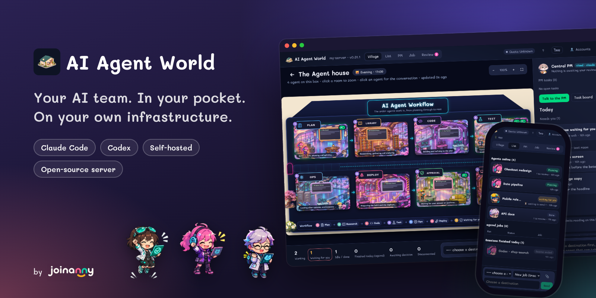
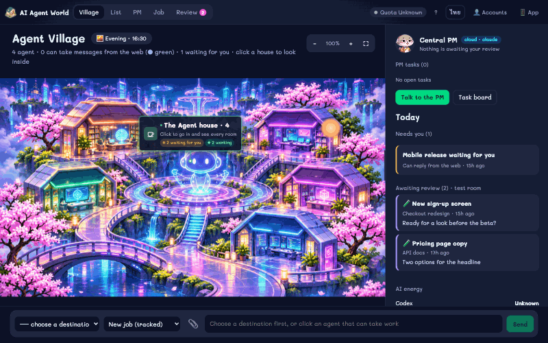
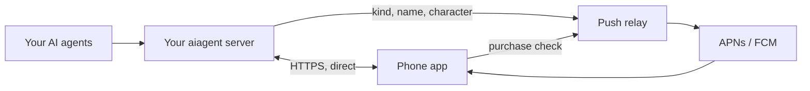

<p align="center">
  
</p>

# AI Agent World

**Your AI team. In your pocket. On your own infrastructure.**

A self-hosted personal command center for Claude Code and Codex. See the real
AI agent sessions on your machine come to life, follow their progress, and
answer them from your phone.

One person. Many agents. One world.

[Quick Start](#quick-start) · [Releases](https://github.com/hotkhwan/aiagent/releases) · [Phone app (beta)](#phone-app) · [Security](docs/SECURITY.md) · [Advanced install](docs/INSTALL.md)

[](LICENSE)
[](https://github.com/hotkhwan/aiagent/releases)
[](https://github.com/hotkhwan/aiagent/releases)
[](https://github.com/hotkhwan/aiagent/actions/workflows/ci.yml)
[](https://github.com/hotkhwan/aiagent)

<p align="center">
  
  <br><sub>Captured from a real aiagent instance running demo sessions.</sub>
</p>

> **Status: alpha.** It has been run by its author on one machine. The security
> model below is real and tested, but this has not had an outside audit, and
> the UI defaults to Thai. See [Known gaps](#known-gaps).

## Why AI Agent World

A pastel village in your browser that shows the AI coding agents actually
running on your machine — Claude Code and Codex — and lets you send them work
through a narrow, audited channel.

- **Real sessions, not a simulation.** Every character moves because a
  session's state changed on disk: no decorative animation stands in for work
  that is not happening.
- **Claude Code and Codex in one place.** Sessions you started in a terminal,
  in VS Code, in tmux or as background jobs, grouped into houses and rooms.
- **Your agents walk to their work.** Plan, research, build, test, deploy,
  waiting for you, resting: an agent goes to the room that matches what it last
  actually did.
- **Answer from anywhere.** Reply to an agent that is waiting for you, from the
  browser or the phone app, through a narrow, audited channel.
- **Your machine, your accounts.** The server is open source and runs where
  your agents run. Bring your own AI accounts; nothing is resold.

### What you see

- **Houses** group sessions by where they came from: a tmux/dispatcher house, a
  Claude background-daemon house, and a read-only house for sessions you
  started in a terminal or VS Code.
- **Eight rooms** in workflow order — plan, research, build, test, system,
  deploy, waiting for you, resting — and an agent walks to the room that
  matches what it last actually did (classified from its most recent tool
  call).
- **In a room**: a TV with the latest message (click to enlarge), an NPC that
  explains the room, draggable characters, a sky that follows the time of day,
  and a warm or green glow around Claude and Codex agents respectively.
- **Markdown is rendered**, not shown raw — headings, lists, tables, code
  blocks and links, in the conversation and on the room monitor.
- **Room to read**: every dialog has a full-screen toggle (or press **F**) and
  a drag corner; the side panel has a drag edge and can be thrown up as a
  full-size sheet. Widths are remembered.
- **Right panel**: the session's conversation with secrets stripped out,
  sub-agents and what each was given, the model in use with a menu to change
  it, and a stop button.
- **Quota** is read, never guessed: Claude from its status line (5-hour and
  7-day windows), Codex from the rollout's `rate_limits`. When there is no
  reading, the UI says so instead of inventing a number.

## Quick Start

### What you need

| | |
|---|---|
| A computer that runs your agents | macOS or Linux, arm64 or amd64 |
| Agents to look at | [Claude Code](https://docs.anthropic.com/en/docs/claude-code) and/or [Codex CLI](https://github.com/openai/codex), signed in with your own account |
| To check the release signature | OpenSSL 3 (macOS ships LibreSSL: `brew install openssl@3` first) |
| To send messages to agents | `tmux` (viewing works without it) |

### Platform support

| Platform | Prebuilt release | Viewer for one user (`install.sh`) | Full Linux server with rooms (`setup.sh`) |
|---|---|---|---|
| macOS arm64 / amd64 | Yes | Yes | No |
| Linux arm64 / amd64 | Yes | Yes | Yes, Ubuntu or Fedora family with systemd |
| Windows | No | No | No |

On macOS, Codex sessions show from their rollout files only (see
[Known gaps](#known-gaps)). There is no Docker image.

### Install, enable, open

Download the installer, read it, then run it. It fetches this machine's
archive from the latest release, verifies the ed25519 signature and the
checksum, and only then installs `aiagent` and `agcmd` into `~/.local/bin`
(make sure that is on your `PATH`). It needs no root.

```sh
curl -fsSLO https://raw.githubusercontent.com/hotkhwan/aiagent/main/packaging/install-release.sh
less install-release.sh          # read it first
sh install-release.sh
aiagent enable                   # prints a token ONCE; only its SHA-256 is stored
aiagent serve                    # http://127.0.0.1:8890/aiagent
```

Open `http://127.0.0.1:8890/aiagent` on the same computer and paste the token.
Until you run `enable`, **every route answers 404**, and the service refuses to
listen on anything but loopback without a TLS certificate.

On a Mac mini (arm64, release v0.36.2) the download, signature check and
install took about 2 seconds; the page answered right after `aiagent serve`.

To build from a checkout instead, or to install the service unit and the agent
CLIs as well, see [Just the viewer, for one user](docs/INSTALL.md#just-the-viewer-for-one-user).
For a Linux server with rooms, see [The whole thing, on a Linux server](docs/INSTALL.md#the-whole-thing-on-a-linux-server).

### Install from a release (no Go, no checkout)

Every version is published on
[GitHub Releases](https://github.com/hotkhwan/aiagent/releases) as
`aiagent_<ver>_<os>_<arch>.tar.gz` (darwin/linux, arm64/amd64; each holds only
`aiagent` and `agcmd`), with `SHA256SUMS` and `SHA256SUMS.sig`, an ed25519
signature of `SHA256SUMS` made with the owner's release key. The public key is
compiled into aiagent and is [`packaging/release-pubkey.pem`](packaging/release-pubkey.pem).

```sh
curl -fsSL https://raw.githubusercontent.com/hotkhwan/aiagent/main/packaging/install-release.sh | sh
# or a given version, into /usr/local/bin:
curl -fsSL https://raw.githubusercontent.com/hotkhwan/aiagent/main/packaging/install-release.sh | PREFIX=/usr/local sh -s v0.36.0
```

It downloads this machine's archive, checks the signature (with OpenSSL 3, or
with an `aiagent` already installed) and the checksum, and only then installs
the two binaries. It does not set up the service or the agent CLIs: for those
run `packaging/install.sh` from a checkout once, or set up the unit by hand.

To check a download yourself instead (OpenSSL 3; macOS: `brew install openssl@3`):

```sh
base64 -d < SHA256SUMS.sig > sig.bin
openssl pkeyutl -verify -pubin -inkey release-pubkey.pem -rawin -in SHA256SUMS -sigfile sig.bin
shasum -a 256 -c SHA256SUMS --ignore-missing     # Linux: sha256sum -c --ignore-missing
```

or, from an aiagent you already trust, `aiagent verify-release DIR` (a folder
holding the three files).

**Updating:** once installed, the admin sees a 🔔 in the header when a newer
release is out; one click downloads it, verifies the signature and checksum,
replaces both binaries next to the running one (the old ones stay as
`aiagent.prev` / `agcmd.prev`) and restarts the service. A machine installed
from a checkout keeps the git update in 👤 Accounts as well.

## Phone app

**AI Agent World** for iPhone and Android: see what waits for you (an agent's
question, a blocked agent, a review), answer it, and command your agents by text,
picture or voice, with a notification when one needs you or finishes. It talks to
your own aiagent server; nothing passes through anyone else's except the push
relay, which carries a session name and never a token or a conversation.

1. Run aiagent on your computer (below).
2. On its web page press **📱 App**: it shows a one-time pairing QR (works once,
   within 10 minutes; **Download image** saves it for opening from Photos/Files).
3. In the app press **Scan QR**.

### Reach it from your phone

The phone needs an **https** address; `http://127.0.0.1:8890` exists only on
the computer itself. [docs/PUBLIC_URL.md](docs/PUBLIC_URL.md) is a playbook
for that — a quick Cloudflare tunnel to try, a named tunnel on your own
Cloudflare account, a cloud server with Caddy, or Tailscale — written so one
of your own agents can follow it, asking you before it opens anything. Opened
on `127.0.0.1`, the **📱 App** dialog offers to send those instructions to an
agent for you. Pair after opening the page through the new address: the QR
carries the address the page was opened with.

The app is in TestFlight beta (iOS). `--push-relay` picks the notification relay
or turns notifications off.

## Personal use — one human, many agent roles

AI Agent World is for **one human owner** managing their own agent sessions
and work. A room is a role for an agent, not a seat for another person.

- **Bring your own AI account**, and use it only as its provider allows.
- We do not resell AI subscriptions or tokens, pool accounts, share credentials
  between people, or work around usage limits.
- People on a provider's team or business plan use their own assigned login.
- AI Agent World is independent of Anthropic, OpenAI and Google.

## Pricing — planned launch

| | Community | Pro Monthly | Pro Annual |
|---|---|---|---|
| Price | Free | $1.99 / ฿69 a month | $16.99 / ฿599 a year |
| Self-hosted server, web dashboard and PWA | Yes | Yes | Yes |
| Connect the phone app and look around | Yes | Yes | Yes |
| Command agents from the phone (text, picture, voice) | — | Yes | Yes |
| Push notifications | — | Yes | Yes |
| Profiles and agent sessions | No limit | No limit | No limit |
| Free trial | — | 7 days | 7 days |

Prices and availability depend on the store region and the release. AI
provider charges are separate: you bring your own account. Restore purchases
in the app. The server stays open source; donations
help its development. App terms: [docs/APP_TERMS.md](docs/APP_TERMS.md).

## Architecture and privacy



Agents, credentials, conversations and source code stay on the machine you
control. The only managed service is the push relay (Cloudflare Workers): it
knows a device's push token and your server's address, and per notification
the kind of event, the session name and its character, never a token or a
conversation. Names can be hidden on the phone (*Hide agents' names in
notifications*). Notifications are best effort; the web dashboard never
depends on the relay.

The AI providers still process what you send to their agents under their own
terms and data policies; running the server yourself does not change that.

## Security and limitations

### Security

The short version: loopback by default, 404 until enabled, a hashed token, no
shell anywhere, secrets stripped before anything reaches the browser, and an
append-only audit log that records the intent before the action. The long
version, including what is **not** protected, is in
[docs/SECURITY.md](docs/SECURITY.md).

### Known gaps

- **The UI is Thai first.** It ships Thai and English (`web/i18n.js`, `?lang=en`
  or the TH|EN switch); server-side reason strings are still Thai only.
- **Codex liveness needs `/proc`.** Process discovery reads `/proc` on Linux
  and `ps` where there is none (macOS), so pid-based liveness of Claude
  sessions, the pane-ancestry check behind dispatch, `claude attach` panes and
  telling codex or gemini apart from a node REPL work on both. What still
  needs `/proc` is Codex presence and the open-rollout check, which read a
  process's working directory and file descriptors; on macOS Codex sessions
  show from their rollout files only.
- **No tests for the browser code.** The Go side has tests and the embedded
  art is checked against its spec (`go test ./...`), but `web/app.js` itself
  has none.
- Alpha: one author, one machine, no external security review.

## Contribute and support

- **Questions, bugs, install problems:** [open an issue](https://github.com/hotkhwan/aiagent/issues/new/choose).
  Never paste tokens, pairing QR codes, credentials or unredacted logs.
- **Security problems:** do not open a public issue; see
  [Reporting a vulnerability](docs/SECURITY.md#reporting-a-vulnerability).
- **Code:** read [CONTRIBUTING.md](CONTRIBUTING.md) first. Everyone here follows the
  [Code of Conduct](CODE_OF_CONDUCT.md).
- **Like it?** A star helps other people find the project. So does telling us
  what you use it for, or what got in your way while installing it.

## Support the project

If AI Agent World helps you, consider giving the repository a star,
sharing feedback, or sponsoring open-source development.

[Become a sponsor](https://github.com/sponsors/hotkhwan)

Sponsorship is optional and does not unlock Mobile Pro features.

## More documentation

| Document | What is in it |
|---|---|
| [docs/INSTALL.md](docs/INSTALL.md) | Full Linux server setup, rooms, room pages, workspaces, trusted roots, status line, tab completion, review pages, removing it, cutting a release |
| [docs/PUBLIC_URL.md](docs/PUBLIC_URL.md) | Getting an https address for the phone |
| [docs/SECURITY.md](docs/SECURITY.md) | Threat model and what is not protected |
| [docs/ARCHITECTURE.md](docs/ARCHITECTURE.md) | How it is built |
| [docs/ASSETS.md](docs/ASSETS.md) | Where the images come from, and their CC BY 4.0 licence |
| [docs/APP_TERMS.md](docs/APP_TERMS.md), [docs/APP_PRIVACY.md](docs/APP_PRIVACY.md), [docs/APP_SUPPORT.md](docs/APP_SUPPORT.md) | Phone app terms, privacy and support |

## Licence

Code: [Apache-2.0](LICENSE). Images in `web/assets/`: © JOINANNY,
[CC BY 4.0](LICENSE-ASSETS.md), generated with AI (ChatGPT); provenance in
[docs/ASSETS.md](docs/ASSETS.md).

"Claude" is a trademark of Anthropic and "Codex" of OpenAI. This project is not
affiliated with, endorsed by, or sponsored by either; it only talks to their
command-line tools, and uses neutral marks (`✻`, `>_`) rather than their logos.
