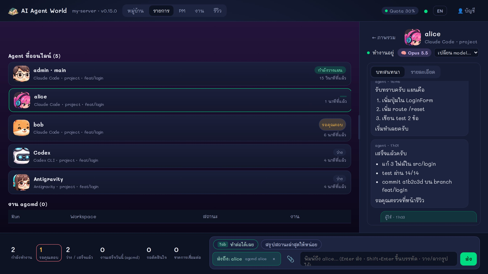
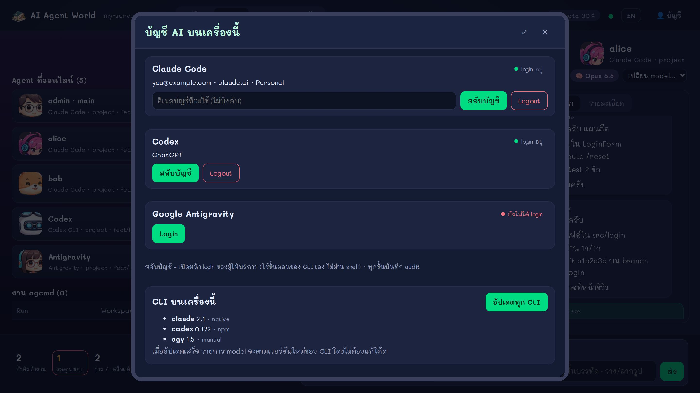
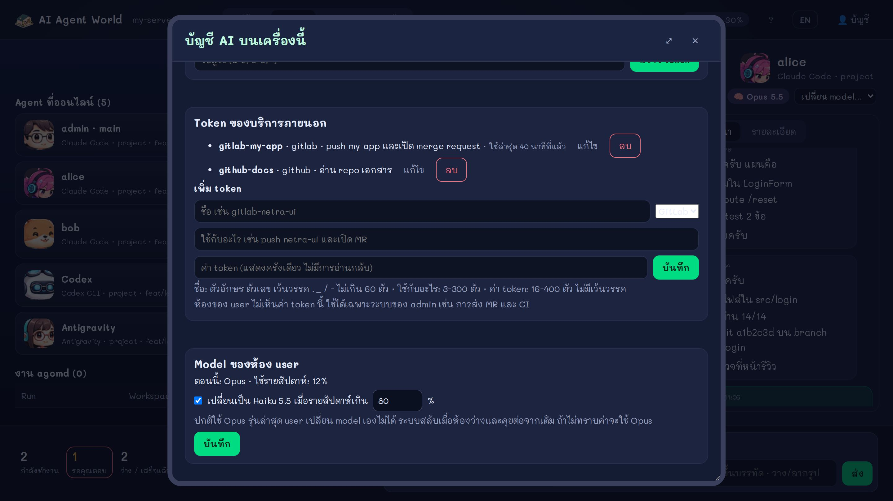
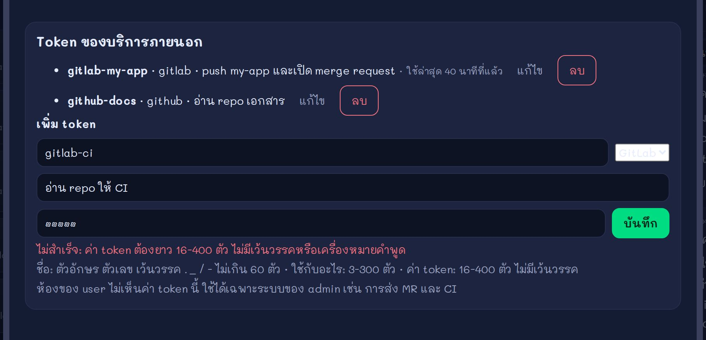

# คู่มือผู้ดูแล AI Agent World

คู่มือนี้สำหรับคนที่ถือ **token admin**: ติดตั้ง ดูแลบัญชี สร้างและลบห้อง กำหนด model และกติกากลาง

## 1. ภาพรวม



| ส่วนประกอบ | หน้าที่ |
| --- | --- |
| `aiagent` | บริการเว็บ อ่านสถานะ agent และรับคำสั่ง |
| `agcmd` | เครื่องมือเล็กที่พิมพ์ข้อความเข้า agent ผ่าน tmux |
| tmux session ของ site | หน้าต่างเมนู, Codex และ Antigravity |
| ห้อง | OS user แยก มี aiagent, tmux และ Claude ของตัวเอง |
| Agent CLI | Claude Code, Codex, Antigravity (`agy`) |

## 2. ติดตั้ง

บน Linux server เปล่า (Ubuntu หรือ Fedora ที่มี systemd) ใช้คำสั่งเดียว รันใน terminal ของคุณเอง:

```
git clone https://github.com/hotkhwan/aiagent.git
cd aiagent
sudo ./packaging/setup.sh --site ชื่อไซต์
```

| ตัวเลือก | ความหมาย |
| --- | --- |
| `--site NAME` | ชื่อ tmux session (ค่าเริ่มต้นคือชื่อเครื่อง) |
| `--code DIR` | โฟลเดอร์โค้ดที่ Codex และ Antigravity อ่านได้ |
| `--listen ADDR:PORT` | ที่อยู่ของเว็บ (ค่าเริ่มต้น `127.0.0.1:8890`) |
| `--agy-sandbox` | Ubuntu: เพิ่ม AppArmor profile ให้ sandbox ของ Antigravity ทำงาน |

สคริปต์ลงสิ่งที่ขาด (Go, tmux, git, Node.js และ CLI ทั้งสาม) สร้างบริการ เปิดใช้งาน แล้วพิมพ์ **token admin หนึ่งครั้ง** เก็บไว้ใน password manager

เว็บฟังที่เครื่องตัวเองเท่านั้น ให้วางหลัง reverse proxy ที่มี TLS หรือเครือข่ายส่วนตัว อย่าเปิด port ตรง

## 3. ตั้งค่าครั้งแรก

1. ใน terminal เดิม: `claude setup-token` แล้ว `aiagent-claude-token set` เพื่อให้ทุกห้องใช้ login Claude เดียวกัน
2. เปิดเว็บ วาง token admin
3. กด **บัญชี** แล้ว login Claude, Codex และ Google Antigravity ทีละเจ้า: กด Login เปิดลิงก์ แล้ววางรหัสกลับในหน้าเว็บ



ห้ามทำขั้น token ผ่าน agent หรือแชต เพราะ token จะค้างในบทสนทนา ข้อกำหนดของ Antigravity จำกัดการใช้เครื่องมือภายนอก อ่านก่อนให้ agent อื่นสั่งงาน

## 4. ห้อง



| งาน | วิธี |
| --- | --- |
| สร้างห้อง | บัญชี → Token ของผู้ใช้ → พิมพ์ชื่อ → สร้าง token (แสดงครั้งเดียว) |
| เข้าไปดูในห้อง | ปุ่ม **เข้าห้อง / login** หรือคลิก session ของห้องในรายการ |
| สั่งงานหรือหยุดห้อง | เลือก session ของห้องในรายการ แล้วพิมพ์หรือกดหยุดได้เลย |
| ลบห้อง | **เพิกถอน**: หยุด agent, สำรอง home ไว้ที่ `/var/backups/aiagent-users`, ลบ OS user |

ห้องใหม่เริ่มใน auto mode จึงไม่มีใครต้องตอบคำถามสิทธิ์ที่ terminal

### หน้าพรีวิวของห้อง (ไม่บังคับ)

แต่ละห้องมีหน้า `https://<preview host>/dev/<ห้อง>/` ให้เจ้าของห้องกับ admin ดูงานที่ agent กำลังสร้าง เปิดจากปุ่ม **พรีวิว**

| งาน | วิธี |
| --- | --- |
| เปิดใช้ | ใส่ `HOST` ใน `/etc/aiagent/preview.conf` (ต้องเป็นคนละชื่อกับเว็บ aiagent) แล้ว restart `aiagent@root` |
| เส้นทาง | reverse proxy หรือ gateway ส่งเฉพาะ `/dev/<ห้อง>` มาที่ `LISTEN` (ค่าเริ่มต้น `127.0.0.1:8891`) |
| Kubernetes | ใส่ `GATEWAY` ถึง `PORT` แล้ว `systemctl enable --now aiagent-preview-routes.timer` |
| ชื่อที่ห้ามใช้เป็นห้อง | มีชุดพื้นฐาน (ci, cd, api, …) เพิ่มได้ที่ `RESERVED` |
| จับภาพ | ใส่ `CHROMIUM` (chrome-headless-shell ใต้ `/opt` หรือ `/usr`) และติดตั้งฟอนต์ไทยบนเครื่อง |
| agent ของห้องจับภาพเอง | `aiagent capture` ในห้อง ได้ไฟล์ 390 และ 1440 px ใน `~/work/.aiagent/captures/` บริการ admin ถามห้องผ่าน socket ของห้องนั้นเอง ทีละครั้ง ไม่เกิน 20 ครั้งต่อชั่วโมงต่อห้อง และบันทึก audit (`aiagent.roomCapture`) |
| ปิดสิทธิ์ | เพิกถอนหรือออก token ใหม่ของห้อง ทุกหน้าที่เปิดอยู่ของห้องนั้นใช้ไม่ได้ทันที |

ห้องเลือกเองว่าแสดงอะไรใน `~/work/preview.json` (โฟลเดอร์ หรือพอร์ต 3000-5999 ที่ user ของห้องเปิดเอง) หน้าเว็บถูกครอบ sandbox ไม่มี cookie และไม่มีสิทธิ์ของโดเมนนั้น

### หน้ารีวิวของห้อง

หน้าที่ agent ของห้องส่งด้วย `aiagent review` (หรือภาพจากปุ่ม **ส่งเข้ารีวิว** ในหน้าพรีวิว) อยู่ในมุมมอง **รีวิว** ทั้งของเจ้าของห้องและของ admin พร้อมชื่อห้อง ทั้งสองฝั่งเปิดหน้าเดียวกัน ตรวจทีละข้อ (**ผ่าน** / **ต้องแก้ไข**) แล้ว **ยืนยันผลตรวจ** ได้ ส่วน admin ส่งงานที่ผ่านแล้วต่อให้ session ของตัวเองตรวจ diff, push และเปิด merge request ได้จากหน้าเดียวกัน

ลิงก์เปิดหน้าใช้ได้ครั้งเดียวและหมดอายุใน 2 นาที หน้าถูกครอบ sandbox ถ้าเปิดแล้วว่าง ให้ปิดแล้วเปิดใหม่จากรายการ

## 5. Token ของบริการภายนอก (vault)



เก็บ access token ของ GitLab, GitHub และบริการอื่นที่ admin ใช้ เช่นการ push และเปิด merge request ที่ **บัญชี → Token ของบริการภายนอก**

| งาน | วิธี |
| --- | --- |
| เพิ่ม | ใส่ชื่อ (ตัวอักษร ตัวเลข เว้นวรรค `. _ / -` ไม่เกิน 60 ตัว), ประเภท, ใช้กับอะไร (3-300 ตัว) และค่า token (16-400 ตัว) แล้วกด **บันทึก** |
| แก้ไข | กด **แก้ไข** ที่รายการ เปลี่ยนชื่อ ประเภท หรือคำอธิบายได้ ช่องค่า token เว้นว่าง = ใช้ค่าเดิม |
| ลบ | กด **ลบ** แล้วยืนยัน ระบบที่ใช้ token นั้นจะใช้ไม่ได้จนกว่าจะใส่ใหม่ |
| ถ้าบันทึกไม่ผ่าน | ข้อความ error ขึ้นใต้ฟอร์ม และสิ่งที่พิมพ์ไว้ยังอยู่ แก้แล้วกดบันทึกใหม่ |

ค่า token ส่งถึง server ครั้งเดียวและไม่มีการอ่านกลับ รายการแสดงแค่ชื่อ ประเภท ใช้กับอะไร และเวลาที่ใช้ล่าสุด ค่าเก็บในไฟล์ที่อ่านได้เฉพาะ root ห้องและ token ของห้องเข้าถึงไม่ได้ เก็บได้สูงสุด 50 รายการ ชื่อซ้ำไม่ได้ (ไม่สนตัวพิมพ์เล็กใหญ่)

ใช้กับ git ผ่าน credential helper ที่ตอบเฉพาะ https ของผู้ให้บริการของ token นั้น (GitLab → gitlab.com, GitHub → github.com):

```
git -c credential.helper= -c 'credential.helper=!aiagent git-credential --name ชื่อรายการ' push
```

ห้ามวาง token ในแชตหรือให้ agent อ่าน ให้ใส่ที่ฟอร์มนี้เท่านั้น

## 6. สิทธิ์

| | Token admin | Token ห้อง |
| --- | --- | --- |
| Session ของตัวเอง | อ่าน ส่ง | อ่าน ส่ง ตั้งชื่อ |
| ห้องอื่น | อ่าน ส่ง หยุด ลบ | อ่านอย่างเดียว |
| Session ของ admin | อ่าน ส่ง | เห็นแค่สถานะ |
| PM, งาน, บัญชี, token, อัปเดต CLI | ได้ | ไม่ได้ |
| เลือก model | ได้ | ไม่ได้ |
| Vault (token ของบริการภายนอก) | ได้ | ไม่เห็นและใช้ไม่ได้ |
| ตอบคำถามของ agent จากเว็บ | ทุกห้อง | เฉพาะห้องตัวเอง |
| ตรวจหน้ารีวิวของห้อง | ทุกห้อง | เฉพาะห้องตัวเอง |

## 7. Model และ quota

- ห้องใช้ Opus รุ่นล่าสุด และเปลี่ยนเป็น Haiku เมื่อโควตารายสัปดาห์เกินเกณฑ์ที่ตั้ง (ค่าเริ่มต้น 80%) กลับเป็น Opus เมื่อต่ำกว่าเกณฑ์ 5 จุดหรือขึ้นรอบใหม่
- ตั้งเกณฑ์ที่ บัญชี → Model ของห้อง user
- ระบบอ่านโควตาของ Claude และ Antigravity เองทุก 5 นาที ส่วน Codex อ่านจากบทสนทนาล่าสุด
- ป้าย **Quota** บนแถบบนแสดงค่าที่ใช้ไปสูงสุด กดเพื่อดูแยกรายเจ้า

## 8. กติกา skill และ memory กลาง

ห้องเป็น home ใหม่ ไม่มี skill, memory หรือ `CLAUDE.md` ของคุณ ระบบส่งให้เองทุก 1 นาที ทั้งห้อง Claude และ Codex/Antigravity (เป็น `AGENTS.md`) ตั้งค่าที่ `/etc/aiagent/share.conf`:

| สิ่งที่แชร์ | ที่มา |
| --- | --- |
| กติกาของ agent | `BASE=/etc/aiagent/room-base.md` |
| กติกาของโปรเจกต์ | `RULES=/path/to/CLAUDE.md` |
| Skill | `SKILLS=~/.claude/skills` ทั้งหมด |
| Memory | `MEMORY=/path/to/memory` เฉพาะไฟล์ที่มี `share: rooms` ใน frontmatter |

ไฟล์ที่ดูเหมือนมี secret จะถูกข้าม ดูได้ด้วย `journalctl -u aiagent-room-share` agent เห็นของใหม่เมื่อเริ่มใหม่

## 9. tmux

```
tmux attach -t ชื่อไซต์
```

หน้าต่างแรกเป็นเมนู session ด้วยชื่อเดียวกับบนเว็บ พิมพ์เลขแล้ว Enter เพื่อเข้า

| ต้องการ | กด |
| --- | --- |
| ไปหน้าต่าง codex / agy | Ctrl-b แล้ว 1 หรือ 2 |
| ออกจากห้องที่ซ้อนอยู่ | Ctrl-b Ctrl-b d |
| ออกจาก tmux | Ctrl-b d |

## 10. ชั้นป้องกัน

| ชั้น | ทำอะไร |
| --- | --- |
| OS user ต่อห้อง | ห้องอ่านหรือแก้ไฟล์ของห้องอื่นไม่ได้ |
| กรอบของ Codex และ Antigravity | รันเป็น id ไม่มีสิทธิ์ เห็นแค่ระบบ โค้ด (อ่านอย่างเดียว) โฟลเดอร์งาน และ login ของตัวเอง |
| Sandbox ของ CLI | คำสั่ง shell ของ Codex และ Antigravity ไม่มีเครือข่าย |
| `room/settings.json` | ห้ามอ่านไฟล์ secret และห้าม `git push`, `curl`, `scp`, `ssh` |
| เว็บ | ซ่อน token ที่รู้รูปแบบ ปิดคำสั่ง `!` และ `&` ของห้อง |

ข้อความที่แสดงบนจอแล้วยังคัดลอกด้วยมือได้ และการจำกัดเครือข่ายขาออกของห้องเป็นหน้าที่ของ firewall บนเครื่อง

## 11. เครื่องดับหรือ restart

กลับมาเองทั้งหมด: tmux session และหน้าต่าง (แต่ละ agent ต่อจากบทสนทนาล่าสุด), session เบื้องหลังของ Claude ที่เปิดอยู่ก่อนดับ และทุกห้อง login อยู่บนดิสก์ ไม่ต้องทำใหม่

## 12. ถอนการติดตั้ง

```
sudo ./packaging/uninstall.sh            # บริการ โปรแกรม และห้อง (สำรอง home ก่อน)
sudo ./packaging/uninstall.sh --purge    # รวม login บทสนทนา ไฟล์สำรอง โฟลเดอร์งาน และ CLI
```

ถ้าไม่ใส่ `--purge` ติดตั้งใหม่แล้วใช้ต่อจากเดิมได้

## 13. คำสั่งอ้างอิง

| คำสั่ง | ใช้ทำอะไร |
| --- | --- |
| `aiagent status` | ดูว่าเปิดอยู่ไหม |
| `aiagent rotate-token` | ออก token admin ใหม่ |
| `aiagent disable` | ปิดบริการ token เดิมใช้ไม่ได้ |
| `aiagent-claude-token status / set / remove` | login Claude ที่ทุกห้องใช้ร่วมกัน |
| `aiagent git-credential --name NAME` | credential helper ของ git ที่ใช้ token จาก vault |
| `aiagent review --title "…" page.html` | ส่งหน้า HTML เข้ามุมมองรีวิว (agent ใช้) |
| `aiagent capture` | (ในห้อง) จับภาพหน้าพรีวิวของห้องที่ 390 และ 1440 px |
| `agcmd ws list` | workspace ที่สั่งงานได้ และสถานะ |
| `agcmd dispatch NAME "ข้อความ"` | ส่งงานให้ agent ใน workspace |
| `systemctl status aiagent@root` | สถานะบริการเว็บ |
| `journalctl -u aiagent@root -n 50` | log ล่าสุด |

## 14. แก้ปัญหาที่พบบ่อย

| อาการ | ตรวจอะไร |
| --- | --- |
| เว็บตอบ 404 ทุกหน้า | ยังไม่ได้ `aiagent enable` |
| ห้องใหม่ขึ้นว่ายังไม่ได้ login | ยังไม่ได้ `aiagent-claude-token set` หรือ token หมดอายุ |
| ส่งงานให้ Codex/Antigravity ไม่ได้ | `agcmd ws list` ต้องเห็นชื่อ CLI ในช่อง AGENT ถ้าไม่เห็นให้ `systemctl restart aiagent-agents@root` |
| agent ขึ้น "รอคุณตอบ" ค้าง | เปิด tmux ดูคำถามบนจอ ตอบ แล้วส่งใหม่ |
| Antigravity ถามก่อนรันทุกคำสั่ง | sandbox เปิดไม่ได้ ติดตั้งใหม่ด้วย `--agy-sandbox` |
| quota ไม่อัปเดต | `systemctl status aiagent-quota@root.timer` |
| หน้าพรีวิวตอบ 404 | `journalctl -u aiagent@root` ต้องเห็น `preview on …`; ดู `HOST`, เส้นทาง และชื่อสงวน |
| จับภาพไม่ได้ | `journalctl -u 'aiagent-capture@*' -n 20` |
| agent ส่งรีวิวแล้วบอกว่า service ยังไม่รับ | บริการของห้องยังเป็นรุ่นเก่าหรือหยุดอยู่: `systemctl restart aiagent-user@<ห้อง>` หน้าที่ค้างใน `~/work/.aiagent/in` จะถูกส่งเอง |
| หน้ารีวิวของห้องเปิดแล้วว่าง (404) | รุ่นก่อน v0.27.1: อัปเดตแล้วเปิดใหม่ |
| บันทึกใน vault ไม่ผ่าน | อ่านข้อความใต้ฟอร์ม: ชื่อซ้ำ, ความยาว, หรือ vault เต็ม |
| git push ด้วย credential helper ถาม password | ชื่อรายการผิด, ประเภทไม่ตรงกับ host ของ remote หรือ remote ไม่ใช่ https |
| ผู้ใช้ส่งข้อความซ้ำโดยไม่ตั้งใจ | v0.26.0 ขึ้นไปกันไว้แล้ว: ข้อความเดียวกันภายใน 10 วินาทีต้องกดส่งซ้ำเอง |
| กติกากลางไม่ถึงห้อง | `journalctl -u aiagent-room-share -n 20` |
