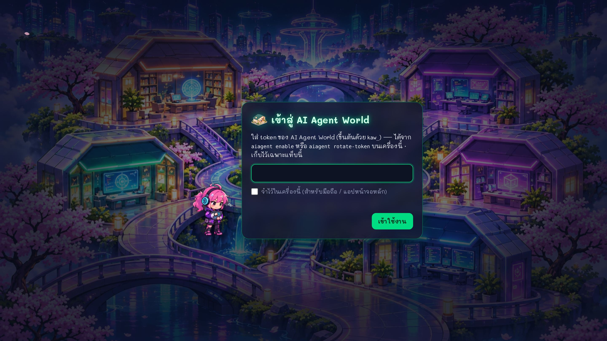
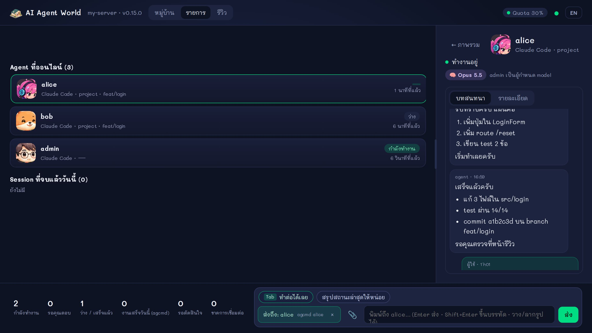
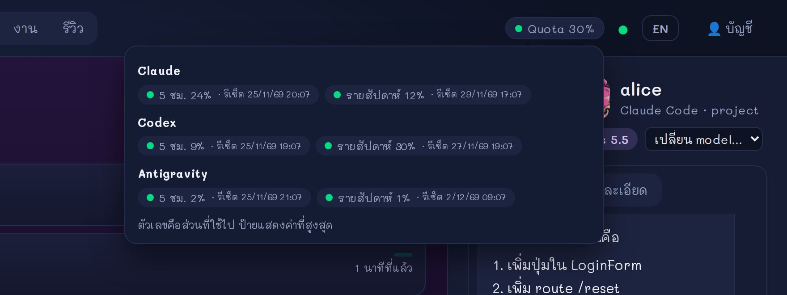
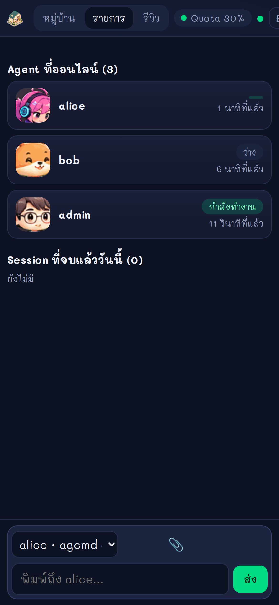
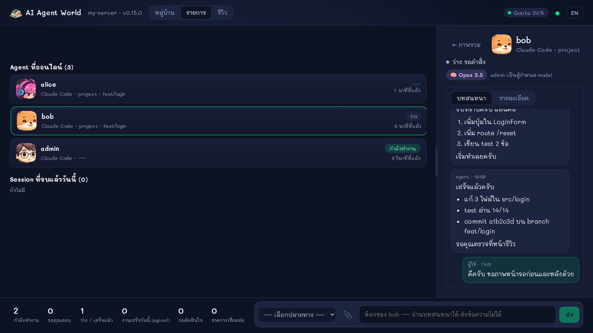

# คู่มือผู้ใช้ AI Agent World

คู่มือนี้สำหรับคนที่ได้ **token ของห้อง** จากผู้ดูแลระบบ ใช้สั่งงาน AI agent ผ่านหน้าเว็บ ไม่ต้องเปิด terminal

## 1. ภาพรวม

AI Agent World คือหน้าเว็บสำหรับดูและสั่งงาน AI agent ที่ทำงานอยู่บนเครื่อง server แต่ละคน (หรือแต่ละงาน) มี **ห้อง** ของตัวเอง ห้องคือพื้นที่ทำงานแยก มี agent หนึ่งตัวรอรับงานอยู่เสมอ

| คำ | ความหมาย |
| --- | --- |
| Agent | AI ที่อ่านโค้ด แก้ไฟล์ และรันคำสั่งตามที่สั่ง |
| ห้อง | พื้นที่ทำงานแยกของคุณ ห้องอื่นแก้ไฟล์ในห้องคุณไม่ได้ |
| Token | รหัสเข้าใช้ของห้อง แสดงครั้งเดียวตอนสร้าง |
| Admin | ผู้ดูแลระบบ สร้างและลบห้อง กำหนด model |

## 2. เข้าใช้งาน

1. เปิดที่อยู่เว็บที่ผู้ดูแลให้ไว้
2. วาง token แล้วกด **เข้าใช้งาน**
3. ถ้าเป็นเครื่องส่วนตัว ติ๊กให้จำ token ได้ เครื่องสาธารณะไม่ควรติ๊ก

Token คือกุญแจของห้อง อย่าส่งต่อในแชตหรืออีเมล ถ้าหลุดให้แจ้ง admin เพื่อออกใหม่

## 3. หน้าจอ

| ส่วน | ใช้ทำอะไร |
| --- | --- |
| แถบบน | สลับมุมมอง หมู่บ้าน / รายการ / รีวิว และป้าย Quota |
| รายการ agent | agent ของคุณ ห้องอื่น (อ่านได้อย่างเดียว) และ admin (เห็นแค่สถานะ) |
| แผงขวา | บทสนทนาและรายละเอียดของ agent ที่เลือก |
| แถบล่าง | ตัวนับสถานะ และช่องพิมพ์ข้อความ |

**ป้าย Quota** แสดงส่วนที่ใช้ไปสูงสุดของแผนที่ใช้อยู่ กดเพื่อดูแยกรายเจ้าและเวลารีเซ็ต

**มุมมองหมู่บ้าน** แสดง agent เป็นตัวละครในห้องต่างๆ ตามงานที่กำลังทำ เช่น ห้องพัฒนา ห้องทดสอบ ห้องพัก คลิกตัวละครเพื่อเปิดแชต

**บนมือถือ** ใช้ได้ครบ หน้าแรกเป็นรายการ

## 4. สถานะของ agent

| สถานะ | ความหมาย | ควรทำอะไร |
| --- | --- | --- |
| กำลังทำงาน | agent กำลังทำตามข้อความล่าสุด | รอ หรือพิมพ์ต่อได้ ข้อความจะถูกเก็บไว้ส่งเมื่อว่าง |
| รอคุณตอบ | agent ถามคำถาม หรือค้างที่คำถามบนจอ | ตอบในช่องพิมพ์ ถ้าตอบไม่ได้ให้แจ้ง admin |
| ว่าง | พร้อมรับงานใหม่ | ส่งงานได้ |

## 5. ส่งงานให้ agent

1. เลือก agent ของคุณในรายการ
2. พิมพ์ในช่องล่าง กด **Enter** เพื่อส่ง (Shift+Enter ขึ้นบรรทัดใหม่)
3. แนบรูปได้ด้วยปุ่มคลิป วาง หรือลากไฟล์มา

เขียนงานให้ agent ทำตามได้ ควรมีสี่อย่าง:

| หัวข้อ | ตัวอย่าง |
| --- | --- |
| ทำอะไร | เพิ่มปุ่ม "ลืมรหัสผ่าน" ในหน้า login |
| เสร็จเมื่อไร | กดแล้วไปหน้า /reset และ test ผ่าน |
| ห้ามแตะอะไร | ไฟล์ config และฐานข้อมูล |
| หลักฐานที่ต้องการ | ผล test และภาพหน้าจอก่อนหลัง |

งานใหญ่ให้แบ่งเป็นข้อความเล็ก ทีละเรื่อง ตรวจทีละขั้น

คำสั่งพิเศษที่พิมพ์ได้: `/compact` (ย่อบทสนทนา), `/clear` (เริ่มใหม่), `/context`, `/usage`, `/rename ชื่อ` คำสั่งอื่นและข้อความที่ขึ้นต้นด้วย `!` หรือ `&` ส่งไม่ได้

## 6. ตรวจงาน

- อ่านสรุปของ agent ในบทสนทนา ดูว่าแก้ไฟล์ไหน test ผ่านไหม
- แท็บ **รายละเอียด** บอก session, branch, เครื่องมือล่าสุด และจำนวน token ที่ใช้
- มุมมอง **รีวิว** รวมหน้าสรุปงานที่ agent ส่งให้ตรวจ ตอบรับหรือขอแก้ได้จากตรงนั้น
- ถ้าไม่ผ่าน ให้บอกสิ่งที่ผิดพร้อมหลักฐาน (ข้อความ error, ภาพหน้าจอ) ในข้อความถัดไป

## 7. สิทธิ์ของห้อง

| เรื่อง | ทำได้ไหม |
| --- | --- |
| สั่งงาน หยุด และตั้งชื่อ agent ของตัวเอง | ได้ |
| อ่านบทสนทนาของห้องอื่น | ได้ อ่านอย่างเดียว |
| อ่านบทสนทนาของ admin | ไม่ได้ เห็นแค่สถานะ |
| เลือก model | ไม่ได้ admin เป็นผู้กำหนด |
| สร้างห้อง จัดการบัญชี | ไม่ได้ |

Model ของห้องเปลี่ยนเองตามกติกาที่ admin ตั้ง เช่น ใช้รุ่นเล็กลงเมื่อโควตารายสัปดาห์ใกล้หมด ระบบสลับตอนห้องว่าง และคุยต่อจากเดิมได้

## 8. กติกาความปลอดภัย

- อย่าสั่งให้ agent อ่านหรือแสดง token, password, secret หรือไฟล์ `.env`
- อย่าสั่งให้ copy โค้ดออกนอกเครื่อง หรือพิมพ์ไฟล์ทั้งไฟล์ลงแชตเพื่อคัดลอก
- อย่าวาง secret ลงในแชต ข้อความถูกเก็บในบทสนทนา
- agent ถูกตั้งให้ปฏิเสธเรื่องเหล่านี้อยู่แล้ว ถ้าเห็น agent ทำ ให้แจ้ง admin

## 9. แก้ปัญหาที่พบบ่อย

| อาการ | สาเหตุที่เป็นไปได้ | ทำอย่างไร |
| --- | --- | --- |
| เข้าไม่ได้ ขึ้นว่า token ผิด | พิมพ์ผิด หรือ token ถูกเพิกถอน | วางใหม่ ถ้าไม่ได้ให้ขอ token ใหม่ |
| ขึ้นว่า token ผิดหลายครั้งเกินไป | ใส่ผิดเกิน 10 ครั้งใน 5 นาที | รอ 5 นาที |
| agent ค้างที่ "รอคุณตอบ" นาน | ค้างที่คำถามบนจอของ agent | กด **หยุด** แล้วส่งใหม่ หรือแจ้ง admin |
| ส่งแล้วขึ้นว่าเก็บข้อความไว้ | agent กำลังทำงาน | รอ ระบบส่งให้เองเมื่อว่าง |
| agent ตอบว่าไม่รู้จักโปรเจกต์ | ยังไม่ได้รับกติกากลาง | แจ้ง admin ให้ตรวจการแชร์กติกา |
| ไม่เห็นเมนู PM หรือบัญชี | เป็นเมนูของ admin | ถูกต้องแล้ว |
