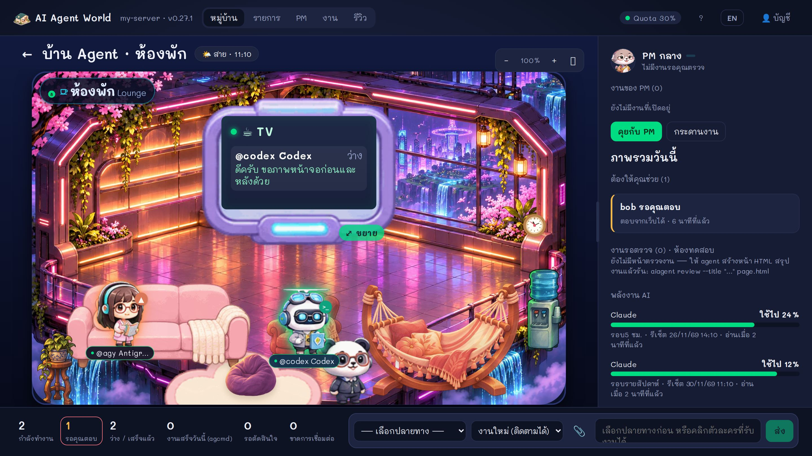
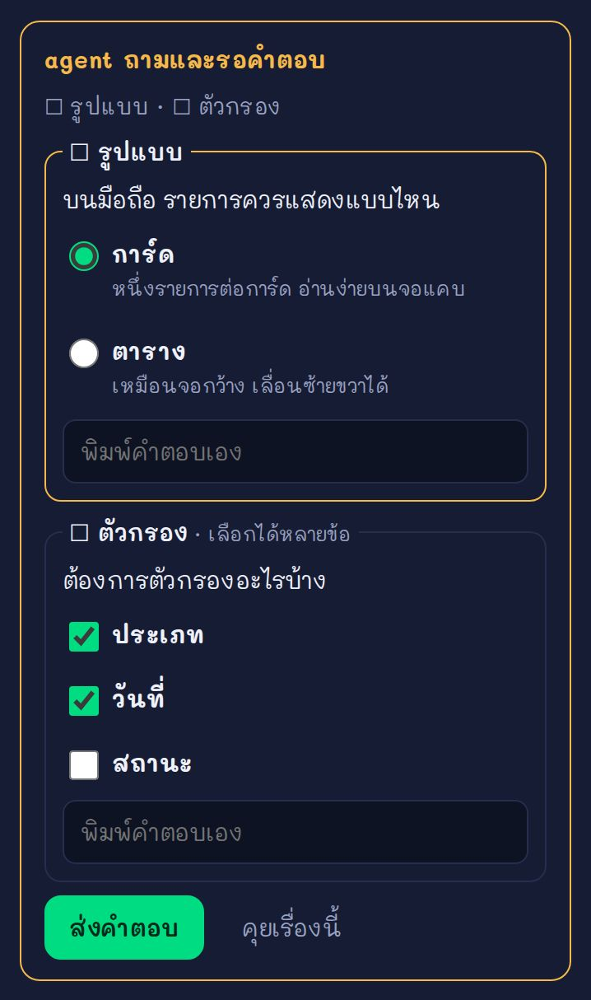
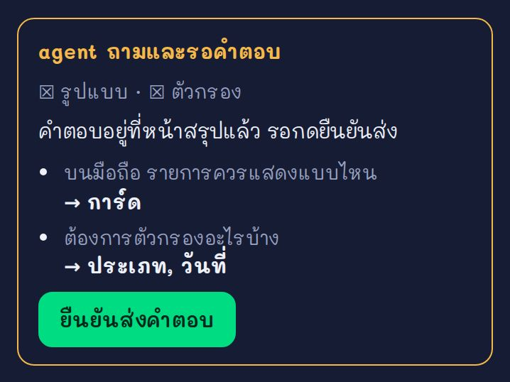
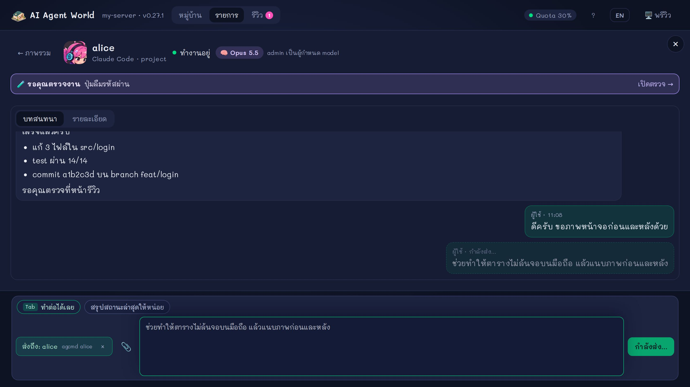
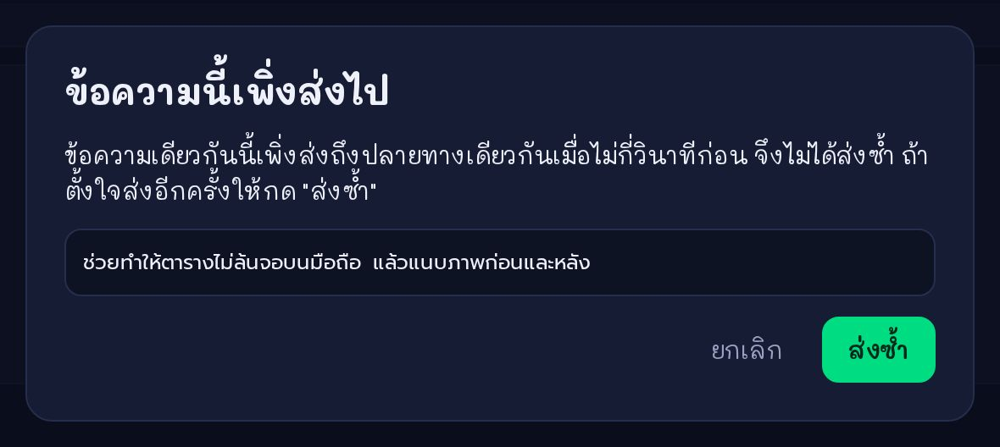
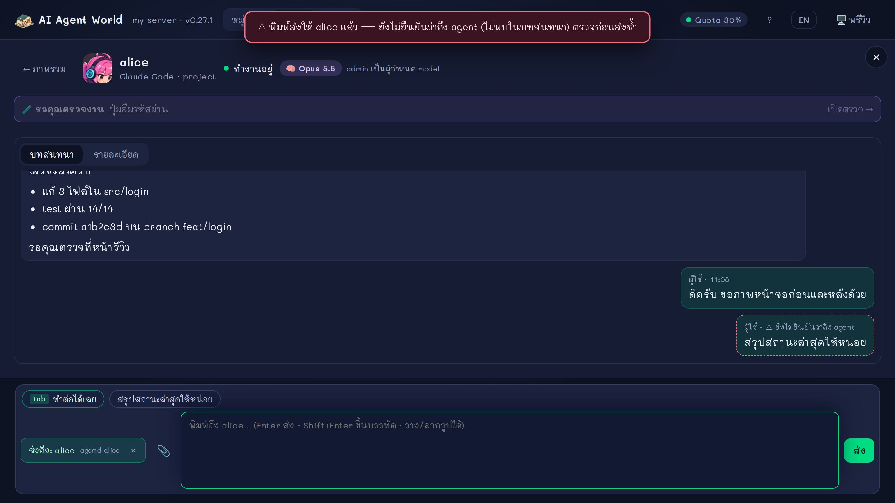
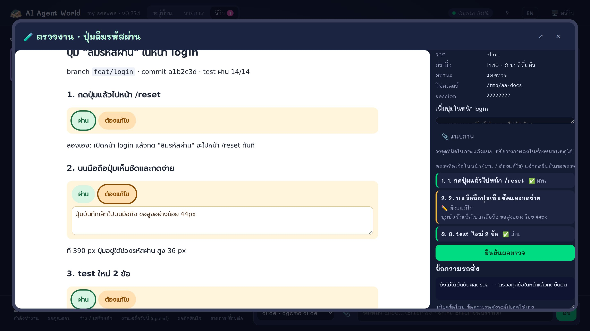
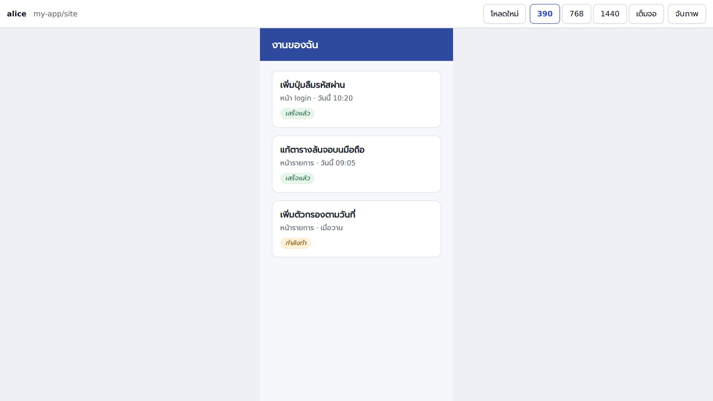
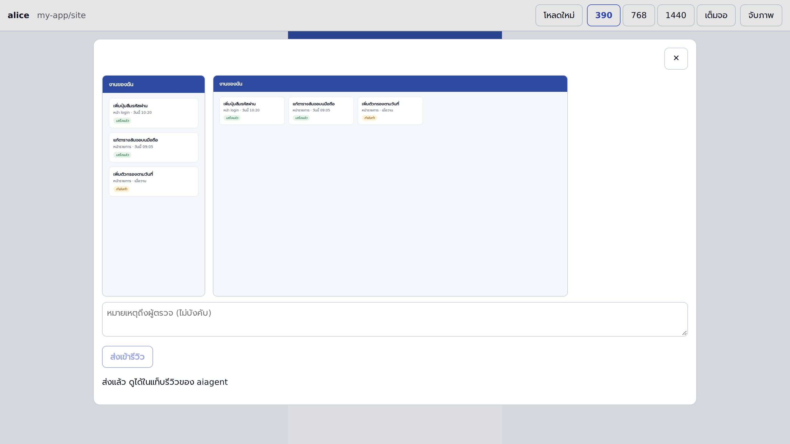

# คู่มือผู้ใช้ AI Agent World

คู่มือนี้สำหรับคนที่ได้ **token ของห้อง** จากผู้ดูแลระบบ ใช้สั่งงาน AI agent ผ่านหน้าเว็บ ไม่ต้องเปิด terminal

## 1. ภาพรวม

AI Agent World คือหน้าเว็บสำหรับดูและสั่งงาน AI agent ที่ทำงานอยู่บนเครื่อง server แต่ละคน (หรือแต่ละงาน) มี **ห้อง** ของตัวเอง ห้องคือพื้นที่ทำงานแยก มี agent หนึ่งตัวรอรับงานอยู่เสมอ

| คำ | ความหมาย |
| --- | --- |
| Agent | AI ที่อ่านโค้ด แก้ไฟล์ และรันคำสั่งตามที่สั่ง |
| ห้อง | พื้นที่ทำงานแยกของคุณ ห้องอื่นแก้ไฟล์ในห้องคุณไม่ได้ |
| Token | รหัสเข้าใช้ของห้อง แสดงครั้งเดียวตอนสร้าง |
| Admin | ผู้ดูแลระบบ สร้างและลบห้อง กำหนด model |

## 2. เข้าใช้งาน

1. เปิดที่อยู่เว็บที่ผู้ดูแลให้ไว้
2. วาง token แล้วกด **เข้าใช้งาน**
3. ถ้าเป็นเครื่องส่วนตัว ติ๊กให้จำ token ได้ เครื่องสาธารณะไม่ควรติ๊ก

Token คือกุญแจของห้อง อย่าส่งต่อในแชตหรืออีเมล ถ้าหลุดให้แจ้ง admin เพื่อออกใหม่

## 3. หน้าจอ

| ส่วน | ใช้ทำอะไร |
| --- | --- |
| แถบบน | สลับมุมมอง หมู่บ้าน / รายการ / รีวิว, ป้าย Quota และปุ่ม **🖥 พรีวิว** (ถ้า admin เปิดไว้) |
| รายการ agent | agent ของคุณ ห้องอื่น (อ่านได้อย่างเดียว) และ admin (เห็นแค่สถานะ) |
| แผงขวา | บทสนทนาและรายละเอียดของ agent ที่เลือก |
| แถบล่าง | ตัวนับสถานะ และช่องพิมพ์ข้อความ |

**ป้าย Quota** แสดงส่วนที่ใช้ไปสูงสุดของแผนที่ใช้อยู่ กดเพื่อดูแยกรายเจ้าและเวลารีเซ็ต

**มุมมองหมู่บ้าน** แสดง agent เป็นตัวละครในห้องต่างๆ ตามงานที่กำลังทำ เช่น ห้องพัฒนา ห้องทดสอบ ห้องพัก คลิกตัวละครเพื่อเปิดแชต

**บนมือถือ** ใช้ได้ครบ หน้าแรกเป็นรายการ

## 4. สถานะของ agent

| สถานะ | ความหมาย | ควรทำอะไร |
| --- | --- | --- |
| กำลังทำงาน | agent กำลังทำตามข้อความล่าสุด | รอ หรือพิมพ์ต่อได้ ข้อความจะถูกเก็บไว้ส่งเมื่อว่าง |
| รอคุณตอบ | agent ถามคำถาม หรือค้างที่คำถามบนจอ | ตอบในกล่องคำถามที่แผงขวา (หัวข้อ 5) ถ้าตอบไม่ได้ให้แจ้ง admin |
| ว่าง | พร้อมรับงานใหม่ | ส่งงานได้ |

## 5. ตอบคำถามของ agent

เมื่อ agent ถามและรอคำตอบ แผงขวาจะมีกล่อง **agent ถามและรอคำตอบ** ตอบจากเว็บได้เลย ไม่ต้องเปิด terminal

- **คำถามเดียว ตัวเลือกเดียว**: กดตัวเลือกแล้วยืนยัน
- **หลายคำถามในชุดเดียว**: เห็นทุกข้อพร้อมกัน แถวบนบอกว่าข้อไหนตอบแล้ว (☒) ข้อไหนยัง (☐)
- **เลือกได้หลายข้อ**: ข้อที่เขียนว่า "เลือกได้หลายข้อ" เป็นช่องติ๊ก
- **พิมพ์คำตอบเอง**: ใช้ช่องใต้ตัวเลือก ถ้าคำถามเลือกได้ข้อเดียว ข้อความที่พิมพ์จะแทนตัวเลือก
- **ส่งคำตอบ**: กดครั้งเดียวส่งทุกข้อ ปุ่มกดไม่ได้จนกว่าจะตอบครบ และบอกว่ายังขาดข้อไหน
- **คุยเรื่องนี้**: ยกเลิกคำถามชุดนี้แล้วพิมพ์คุยต่อในช่องข้อความ คำตอบที่เลือกไว้จะไม่ถูกส่ง

ถ้าบนจอของ agent เป็นหน้าสรุปคำตอบอยู่แล้ว กล่องจะแสดงคำตอบทั้งหมดและปุ่ม **ยืนยันส่งคำตอบ**

ระหว่างนั้น ระบบอ่านจอซ้ำก่อนกดทุกปุ่ม ถ้าคำถามบนจอเปลี่ยนไปจะหยุดและแจ้ง error ให้ดูคำถามใหม่แล้วตอบอีกครั้ง ข้อที่ต้องพิมพ์ใน terminal เท่านั้นจะขึ้นว่า "ข้อนี้ต้องพิมพ์ข้อความ ตอบใน terminal" ให้แจ้ง admin

## 6. ส่งงานให้ agent

1. เลือก agent ของคุณในรายการ
2. พิมพ์ในช่องล่าง กด **Enter** เพื่อส่ง (Shift+Enter ขึ้นบรรทัดใหม่)
3. แนบรูปได้ด้วยปุ่มคลิป วาง หรือลากไฟล์มา

**ข้อความถูกส่งครั้งเดียว** ตั้งแต่กดส่งจนระบบตอบ ปุ่มจะขึ้นว่า **กำลังส่ง…** และกดซ้ำหรือกด Enter ไม่ได้ ข้อความในช่องจะหายเมื่อส่งสำเร็จเท่านั้น ถ้าไม่สำเร็จข้อความยังอยู่ให้ส่งใหม่

| เห็นอะไร | ความหมาย | ทำอย่างไร |
| --- | --- | --- |
| **กำลังส่ง…** | รอ agent รับข้อความ (อาจถึงครึ่งนาทีถ้าต้องเปิด session ต่อ) | รอ |
| หน้าต่าง **ข้อความนี้เพิ่งส่งไป** | ข้อความเดียวกันเพิ่งส่งถึง agent ตัวเดิมภายใน 10 วินาที | กด **ยกเลิก** ถ้าไม่ได้ตั้งใจ กด **ส่งซ้ำ** ถ้าตั้งใจส่งอีกครั้ง |
| **⚠ ยังไม่ยืนยันว่าถึง agent** | ข้อความถูกพิมพ์ให้แล้ว แต่ยังไม่เห็นในบทสนทนาของ agent | เปิดบทสนทนาดูก่อน อย่าเพิ่งส่งซ้ำ |
| agent กำลังแสดงคำถามอยู่ ... ตอบคำถามนั้นก่อนแล้วส่งใหม่ | ถ้าพิมพ์ตอนนี้ ข้อความจะกลายเป็นคำตอบของคำถามบนจอ | ตอบคำถามในกล่องคำถามก่อน (หัวข้อ 5) แล้วส่งใหม่ |

เขียนงานให้ agent ทำตามได้ ควรมีสี่อย่าง:

| หัวข้อ | ตัวอย่าง |
| --- | --- |
| ทำอะไร | เพิ่มปุ่ม "ลืมรหัสผ่าน" ในหน้า login |
| เสร็จเมื่อไร | กดแล้วไปหน้า /reset และ test ผ่าน |
| ห้ามแตะอะไร | ไฟล์ config และฐานข้อมูล |
| หลักฐานที่ต้องการ | ผล test และภาพหน้าจอก่อนหลัง |

งานใหญ่ให้แบ่งเป็นข้อความเล็ก ทีละเรื่อง ตรวจทีละขั้น

คำสั่งพิเศษที่พิมพ์ได้: `/compact` (ย่อบทสนทนา), `/clear` (เริ่มใหม่), `/context`, `/usage`, `/rename ชื่อ` คำสั่งอื่นและข้อความที่ขึ้นต้นด้วย `!` หรือ `&` ส่งไม่ได้

## 7. ตรวจงาน

- อ่านสรุปของ agent ในบทสนทนา ดูว่าแก้ไฟล์ไหน test ผ่านไหม
- แท็บ **รายละเอียด** บอก session, branch, เครื่องมือล่าสุด และจำนวน token ที่ใช้
- มุมมอง **รีวิว** รวมหน้าสรุปงานที่ agent ส่งให้ตรวจ (agent สร้างด้วย `aiagent review`)
- ปุ่ม **🖥 พรีวิว** (ถ้า admin เปิดไว้) เปิดหน้าที่ agent กำลังสร้างที่ `/dev/<ชื่อห้อง>/` เห็นเฉพาะเจ้าของห้องกับ admin และโหลดใหม่เองเมื่อไฟล์เปลี่ยน
- ในหน้าพรีวิว: เลือกความกว้าง 390 / 768 / 1440 กด **จับภาพ** แล้ว **ส่งเข้ารีวิว** เพื่อติ๊กผ่านหรือขอแก้ทีละข้อ
- agent จับภาพหน้าของห้องเองได้ด้วย `aiagent capture` (390 และ 1440 px) เพื่อตรวจก่อนส่งรีวิว และส่งหน้าสรุปด้วย `aiagent review` ภาพและคำขออยู่ใน `~/work/.aiagent/` อย่าลบหรือแก้โฟลเดอร์นี้
- ถ้าไม่ผ่าน ให้บอกสิ่งที่ผิดพร้อมหลักฐาน (ข้อความ error, ภาพหน้าจอ) ในข้อความถัดไป

### ตรวจหน้ารีวิวทีละข้อ

1. เปิดงานในมุมมอง **รีวิว** ใต้หัวข้อแต่ละข้อในหน้า มีปุ่ม **ผ่าน** และ **ต้องแก้ไข**
2. เลือก **ต้องแก้ไข** ต้องพิมพ์ว่าต้องแก้อะไร แนบภาพที่วงจุดผิดได้ด้วยปุ่มแนบภาพ
3. รายการด้านขวาสรุปผลทุกข้อ กด **ยืนยันผลตรวจ** เมื่อครบ ข้อความรอส่งจะสร้างจากผลนั้น แก้ผลข้อไหนข้อความจะอัปเดตเอง
4. กด **ส่งให้ agent** ข้อความถึง session ที่ส่งหน้านั้นมา ถ้าส่งตรงไม่ได้ให้ **คัดลอกข้อความ** ไปวางเอง

ถ้า agent กำลังแสดงคำถามอยู่ ระบบจะไม่ส่งผลตรวจ (ไม่อย่างนั้นข้อความจะกลายเป็นคำตอบ) ให้ตอบคำถามนั้นก่อน แล้วกดส่งใหม่ งานที่ตรวจแล้วส่งซ้ำไม่ได้ แต่ยังคัดลอกข้อความได้

### หน้าพรีวิวของห้อง

| ปุ่ม | ทำอะไร |
| --- | --- |
| **โหลดใหม่** | โหลดหน้าใหม่ (ปกติโหลดเองเมื่อไฟล์เปลี่ยน) |
| **390 / 768 / 1440 / เต็มจอ** | ดูหน้าที่ความกว้างของมือถือ แท็บเล็ต และจอกว้าง |
| **จับภาพ** | ถ่ายหน้าที่ 390 และ 1440 px บนเครื่อง server |
| **ส่งเข้ารีวิว** | ส่งภาพพร้อมหมายเหตุเข้ามุมมองรีวิว เพื่อตรวจทีละข้อ |

## 8. สิทธิ์ของห้อง

| เรื่อง | ทำได้ไหม |
| --- | --- |
| สั่งงาน หยุด และตั้งชื่อ agent ของตัวเอง | ได้ |
| อ่านบทสนทนาของห้องอื่น | ได้ อ่านอย่างเดียว |
| อ่านบทสนทนาของ admin | ไม่ได้ เห็นแค่สถานะ |
| เลือก model | ไม่ได้ admin เป็นผู้กำหนด |
| สร้างห้อง จัดการบัญชี | ไม่ได้ |

Model ของห้องเปลี่ยนเองตามกติกาที่ admin ตั้ง เช่น ใช้รุ่นเล็กลงเมื่อโควตารายสัปดาห์ใกล้หมด ระบบสลับตอนห้องว่าง และคุยต่อจากเดิมได้

## 9. กติกาความปลอดภัย

- อย่าสั่งให้ agent อ่านหรือแสดง token, password, secret หรือไฟล์ `.env`
- อย่าสั่งให้ copy โค้ดออกนอกเครื่อง หรือพิมพ์ไฟล์ทั้งไฟล์ลงแชตเพื่อคัดลอก
- อย่าใส่ password หรือ token ในหน้าพรีวิว หน้านั้นเขียนโดย agent
- อย่าวาง secret ลงในแชต ข้อความถูกเก็บในบทสนทนา
- agent ถูกตั้งให้ปฏิเสธเรื่องเหล่านี้อยู่แล้ว ถ้าเห็น agent ทำ ให้แจ้ง admin

## 10. แก้ปัญหาที่พบบ่อย

| อาการ | สาเหตุที่เป็นไปได้ | ทำอย่างไร |
| --- | --- | --- |
| เข้าไม่ได้ ขึ้นว่า token ผิด | พิมพ์ผิด หรือ token ถูกเพิกถอน | วางใหม่ ถ้าไม่ได้ให้ขอ token ใหม่ |
| ขึ้นว่า token ผิดหลายครั้งเกินไป | ใส่ผิดเกิน 10 ครั้งใน 5 นาที | รอ 5 นาที |
| agent ค้างที่ "รอคุณตอบ" นาน | ค้างที่คำถามบนจอของ agent | ตอบในกล่องคำถาม ถ้าไม่มีกล่องให้กด **หยุด** แล้วส่งใหม่ หรือแจ้ง admin |
| ส่งข้อความหรือผลตรวจแล้วขึ้นว่า agent กำลังแสดงคำถามอยู่ | ข้อความจะกลายเป็นคำตอบของคำถามนั้น | ตอบคำถามก่อน แล้วส่งใหม่ |
| ตอบคำถามแล้วขึ้น error ว่าจอเปลี่ยน | คำถามบนจอเปลี่ยนระหว่างกด | อ่านคำถามที่ขึ้นใหม่แล้วตอบอีกครั้ง |
| ขึ้น "ข้อความนี้เพิ่งส่งไป" | ข้อความเดียวกันส่งไปแล้วภายใน 10 วินาที | กดยกเลิก ถ้าตั้งใจจริงกด **ส่งซ้ำ** |
| ข้อความขึ้น "ยังไม่ยืนยันว่าถึง agent" | ไม่พบข้อความในบทสนทนาของ agent | เปิดบทสนทนาดูก่อนส่งซ้ำ |
| กด **ยืนยันผลตรวจ** ไม่ได้ | ยังมีข้อที่ไม่ได้เลือก หรือเลือกต้องแก้ไขแต่ไม่ได้พิมพ์ว่าแก้อะไร | ตรวจให้ครบทุกข้อ |
| ส่งแล้วขึ้นว่าเก็บข้อความไว้ | agent กำลังทำงาน | รอ ระบบส่งให้เองเมื่อว่าง |
| agent ตอบว่าไม่รู้จักโปรเจกต์ | ยังไม่ได้รับกติกากลาง | แจ้ง admin ให้ตรวจการแชร์กติกา |
| หน้าพรีวิวบอกให้เปิดจากเว็บ aiagent | ลิงก์ใช้ได้ครั้งเดียว หรือ session หมดอายุ (8 ชั่วโมง) | กดปุ่มพรีวิวใหม่ |
| หน้าพรีวิวว่าง | agent ยังไม่สร้างหน้า หรือ dev server ยังไม่เปิด | บอก agent ให้ดู `~/work/preview.json` |
| ไม่เห็นเมนู PM หรือบัญชี | เป็นเมนูของ admin | ถูกต้องแล้ว |
